  

  

**From the sensor to the agent.** I build software across the whole stack: edge devices, backend services, the infrastructure underneath and the AI models on top. Most of my projects cross more than one of those layers, and the ones I enjoy most have to keep working while something is failing. I'm a computer science engineering student at Karunya Institute of Technology and Sciences in Coimbatore, Tamil Nadu, and I'm originally from Kerala.

My main research project is **[FogAI](https://github.com/AdwaithSaji/FogAi)**, a lightweight hybrid decision engine that keeps safety-critical industrial IoT decisions on the fog node instead of waiting on the cloud, and keeps working through network outages. The paper, *FogAI: A Lightweight Hybrid Decision Engine for Low-Latency Safety-Critical Processing in Industrial IoT Fog Nodes*, co-authored with Dr. G Naveen Sundhar, was **accepted and presented at ICNCCom 2026** (online, July 2026). Proceedings are forthcoming. Alongside it, I've co-authored two IEEE conference papers: one on [explainable AI control panels for industrial automation](https://ieeexplore.ieee.org/document/11607101/) (IEHNS 2026) and one on [real-time plastic-bag detection on a Raspberry Pi 5](https://ieeexplore.ieee.org/document/11396307/) (AISP 2025).

**Beyond research**, layer by layer:

- **Models & vision** — [Parallax](https://github.com/febinrenu/PARALLAX), a team hackathon build: a multimodal medical second opinion where every finding must survive a chain of checks before a doctor sees it. I built the out-of-distribution routing and the verification stages (deletion-test faithfulness, perturbation stability, U-Net/MedSAM masks). Also [EVORA](https://github.com/febinrenu/EVORA), a second team hackathon build: plain-English questions over many camera feeds, answered with the camera, the time and an annotated clip (YOLOE, ByteTrack, SigLIP, OSNet re-ID, Ollama). I wrote its project plan and bootstrapped the codebase: module contracts, mocks, contract tests and the team workflow.
- **Agents & LLMs** — an [AI research agent](https://github.com/AdwaithSaji/ai-research-agent) that plans, searches, verifies and cites every claim against real retrieved sources (FastAPI + React); a [RAG e-commerce assistant](https://github.com/AdwaithSaji/gpt4_exp1) with intent routing, FAQ search and review sentiment; and a [learning recommender](https://github.com/AdwaithSaji/Exp4-Personalized-Recommendation-System) that ranks courses with embeddings plus an LLM and refines them from feedback.
- **Services & full-stack** — [Spring MVC and Spring Boot apps](https://github.com/AdwaithSaji/JavaFullStack_exp10) with Hibernate/JPA on PostgreSQL, and a [student results backend](https://github.com/AdwaithSaji/students-result-management) on Express and MongoDB.
- **Infrastructure & DevOps** — the [Sree Saaj platform](https://github.com/AdwaithSaji/sree-saaj-devops-): six microservices behind a JWT gateway, with Terraform, Ansible and Kubernetes configs and Prometheus/Grafana monitoring; plus a [CI pipeline](https://github.com/AdwaithSaji/python-ci-docker-lab) that tests, builds and pushes a Docker image.

Open to research and engineering roles in AI systems, backend and infrastructure.

 

### `01` &nbsp;Selected work

  
  
  
  

 

### `02` &nbsp;Research & publications

- `2026` &nbsp;**FogAI: A Lightweight Hybrid Decision Engine for Low-Latency Safety-Critical Processing in Industrial IoT Fog Nodes** 
  **Adwaith Sajikumar**, G. Naveen Sundhar 
  ICNCCom 2026 · accepted and presented online, July 2026 · proceedings forthcoming · [paper source](https://github.com/AdwaithSaji/FogAi/tree/main/paper) · [code](https://github.com/AdwaithSaji/FogAi)

- `2026` &nbsp;**Designing Human-Centered AI Control Panels for Industrial Automation with Explainable AI** 
  Rishi Jayanath A, **Adwaith Sajikumar**, G. Naveen Sundar, Narmadha 
  IEHNS 2026 · International Conference on Intelligent Engineering and Next-Gen Healthcare Systems · [IEEE Xplore](https://ieeexplore.ieee.org/document/11607101/) · [DOI](https://doi.org/10.1109/IEHNS68708.2026.11607101)

- `2025` &nbsp;**Real-Time Embedded Vision System for Plastic Bag Detection on Raspberry Pi 5** 
  Rishi Jayanath A, **Adwaith Sajikumar**, Johann Shoni George, G. Jaspher W. Kathrine 
  AISP 2025 · 5th International Conference on Artificial Intelligence and Signal Processing · [IEEE Xplore](https://ieeexplore.ieee.org/document/11396307/) · [DOI](https://doi.org/10.1109/AISP68263.2025.11396307)

 

### `03` &nbsp;Stack

| Area | What I use it for |
| :-- | :-- |
| **Languages** | Python · Java · TypeScript · JavaScript · SQL |
| **AI / ML** | LLM pipelines (Ollama, OpenAI-compatible APIs) · RAG and embeddings (Sentence Transformers) · vision (PyTorch, YOLOE, ByteTrack, SigLIP, OSNet) · medical imaging (U-Net, MedSAM, MedGemma) · NumPy · Pandas |
| **Backend** | FastAPI · Pydantic · Flask · Spring Boot (MVC, JPA) · REST and SSE · PostgreSQL · SQLite |
| **Frontend** | React · TypeScript · Vite |
| **Infrastructure** | Docker · Kubernetes · Terraform · Ansible · GitHub Actions · Prometheus · Grafana · NGINX |
| **Tools** | Git · pytest · Maven · Streamlit · LaTeX |

 

### `04` &nbsp;Activity

  

 

  

  <a href="https://github.com/AdwaithSaji/FogAi">FogAI</a> &nbsp;·&nbsp;
  <a href="https://github.com/AdwaithSaji/ai-research-agent">Research Agent</a> &nbsp;·&nbsp;
  <a href="https://github.com/AdwaithSaji?tab=repositories">All repositories</a> &nbsp;·&nbsp;
  <a href="https://www.linkedin.com/in/adhu363/">LinkedIn</a> &nbsp;·&nbsp;
  <a href="mailto:adwaith0363@gmail.com">adwaith0363@gmail.com</a>
  <!-- Add when available:
  &nbsp;·&nbsp; <a href="https://scholar.google.com/citations?user=YOUR-ID">Google Scholar</a>
  -->

